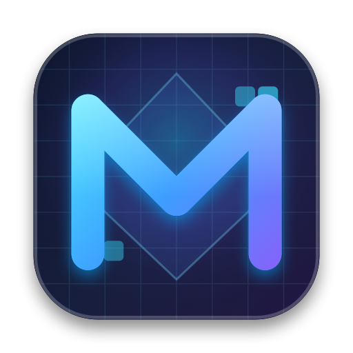

<p align="center">
  
</p>

<h1 align="center">MetalPie</h1>

<p align="center">
  Real-time window upscaling and frame generation for macOS on Apple Silicon.
</p>

<p align="center">
  English · <a href="README.zh-CN.md">简体中文</a>
</p>

---

## Overview

MetalPie captures individual windows via `ScreenCaptureKit`, runs multi-pass Metal / MetalFX upscaling and optional frame interpolation on the GPU, and renders the result into a fullscreen or resizable windowed overlay while keeping mouse input aligned with the scaled coordinates.

## Features

- **Upscaling & Shaders**: 21 built-in presets and 30 GPU effects across 14 `.metal` libraries, including MetalFX Spatial, AMD FSR 1.0 (EASU + RCAS), FXAA 3.11, SGSR, official Anime4K v4.0.1 modes (`Mode A`, `B`, `C`, `A+A`, `B+B`, `C+A`), CuNNy 2×, FSRCNNX 2×, xBRZ, CRT-Geom, CRT-Lottes, Jinc, Lanczos6, CAS, and Apple ML Super Resolution (macOS 26+).
- **Frame Generation**: 2× / 3× / 4× interpolation backed by VideoToolbox ML (`VTFrameProcessor`) on macOS 26+, with a Metal optical-flow fallback on macOS 14–15 and automatic scene-cut / artifact fallback.
- **Fullscreen & Windowed Scaling**: Supports fullscreen overlays (respecting MacBook Pro notch safe areas) and resizable windowed overlays, with 9-point alignment, pixel cropping, and per-application profiles.
- **Input & Cursor Alignment**: Synchronizes clicks, drags, and scroll events with scaled coordinates via `CGEventTap`, scales the active system cursor, detects game mouse-grab, and provides an always-active emergency exit (`⌃⌥⌘⎋`) plus watchdog cursor recovery.
- **Multi-Monitor & Color**: Handles mixed-DPI (`@1x` / `@2x`) and arbitrary monitor layouts, 10-bit wide color / HDR (`RGBA16F`), optional ProMotion VRR direct-scanout, and cursor-free PNG screenshots.
- **Zero-Copy Capture**: Uses `IOSurface` → `CVMetalTextureCache` with no CPU pixel readback on the render path, static-frame power saving, and automatic 1× non-Retina detection for Wine / emulator windows.

## Requirements

- **macOS 14.0+** (Apple Silicon recommended)
- **macOS 15.0+** for HDR capture (`ScreenCaptureKit` HDR)
- **macOS 26.0+** for VideoToolbox ML frame generation and super resolution

## Installation

1. Download the latest `.dmg` from [Releases](https://github.com/Mastarok/MetalPie/releases) and drag `MetalPie.app` into `/Applications`.
2. Release builds are currently ad-hoc signed. If macOS Gatekeeper blocks the first launch, clear the quarantine attribute:
   ```bash
   xattr -dr com.apple.quarantine /Applications/MetalPie.app
   ```
3. Grant permissions in **System Settings → Privacy & Security**:
   - **Screen & System Audio Recording** *(required)*: Used by `ScreenCaptureKit` to capture the target window.
   - **Accessibility** *(required for non-1:1 click alignment)*: Allows `CGEventTap` to remap and confine mouse input onto the scaled window.

## Shortcuts

| Action | Default |
| :--- | :--- |
| Toggle Fullscreen Scaling | `⌥⇧A` |
| Toggle Windowed Scaling | `⌥⇧Q` |
| Toggle Floating Toolbar | `⌥⇧D` |
| Capture Cursor-Free Screenshot | `⌥⇧S` |
| Force Exit Scaling *(always active)* | `⌃⌥⌘⎋` |

## Built-in Scaling Modes

- **3D Games**: MetalFX Spatial, FSR 1.0 (EASU + RCAS), FXAA + FSR 1.0, SGSR
- **Anime & 2D**: Anime4K (`Mode A`, `Mode B`, `Mode C`, `Mode A+A`, `Mode B+B`, `Mode C+A`), CuNNy 2×, FSRCNNX 2×
- **Pixel & Retro**: Integer Scale, Sharp Bilinear, xBRZ, CRT-Geom, CRT-Lottes
- **General & Video**: Lanczos6, Jinc (EWA Lanczos), Bicubic + CAS, Apple ML Super Resolution (macOS 26+)

Custom multi-pass effect chains can be assembled in the **Scaling Modes** tab and exported/imported as JSON.

## Building from Source

Requires macOS 14+ and Swift 6.0+ (Xcode or Apple Command Line Tools; no `.xcodeproj` required).

```bash
# Run unit, Metal shader, and integration tests
./scripts/test.sh

# Build and code-sign dist/MetalPie.app
./scripts/build-app.sh

# Build compressed DMG and SHA-256 checksum (dist/MetalPie-1.0.0-arm64.dmg)
./scripts/build-dmg.sh
```

To preserve macOS TCC permissions across local rebuilds, sign with a local certificate:

```bash
CODESIGN_IDENTITY="Apple Development: Your Name" ./scripts/build-dmg.sh
```

## Project Structure

- `Sources/MetalPieCore` — Domain models (`AppConfig`, `Profile`, `ScalingMode`, `EffectCatalog`), multi-monitor coordinate geometry, layout solver, and atomic JSON config store.
- `Sources/MetalPieShaders` — Runtime MSL compiler with `MTLBinaryArchive` caching, texture pool, MetalFX, VideoToolbox ML, and 14 `.metal` shader libraries.
- `Sources/MetalPieCapture` — Permission checks, window/display enumeration, `ScreenCaptureKit` zero-copy capture, overlay window controller, and render loop.
- `Sources/MetalPieInput` — Pointer mapping, `CGEventTap` cursor controller, global hotkeys, window lifecycle watcher, auto-scale, and recovery watchdog.
- `Sources/MetalPieApp` — SwiftUI / AppKit interface, coordinator, floating toolbar / profiler HUD / toast panels, live split preview, and GPU shader benchmark.

## Acknowledgments

MetalPie draws architectural inspiration and shader algorithms from the following projects:

- [Magpie](https://github.com/Blinue/Magpie) — Window scaling architecture, cursor confinement model, and shader ecosystem.
- [Anime4K](https://github.com/bloc97/Anime4K), [AMD FidelityFX FSR](https://github.com/GPUOpen-Effects/FidelityFX-FSR) / [CAS](https://github.com/GPUOpen-Effects/FidelityFX-CAS), [Qualcomm SGSR](https://github.com/SnapdragonGameStudios/snapdragon-gsr), [CuNNy](https://github.com/funnyplanter/CuNNy), [FSRCNNX](https://github.com/igv/FSRCNN-TensorFlow), and [libretro/slang-shaders](https://github.com/libretro/slang-shaders) — Upscaling algorithms, CRT/pixel-art filters, and neural shader weights.
- [MetalDuck](https://github.com/Nycolazs/MetalDuck) & [MetalGoose](https://github.com/Stallion77RepoOfficial/MetalGoose) — Early macOS Metal window-scaling references.

See [THIRD_PARTY_LICENSES.md](THIRD_PARTY_LICENSES.md) for the complete per-shader provenance table and upstream license notices.

## License

MetalPie is released under the [GNU General Public License v3.0](LICENSE).
